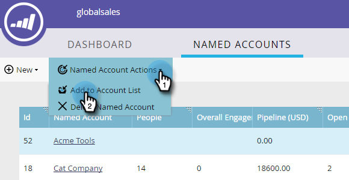

# 新增現有的[!UICONTROL Named Account]至帳戶清單 {#add-an-existing-named-account-to-an-account-list}

將具名帳戶新增至帳戶清單相當簡單。

>[!NOTE]
>
>這僅適用於帳戶清單，**不**&#x200B;動態帳戶清單。

1. 選取要新增至的具名帳戶列。

   

1. 按一下「**[!UICONTROL Named Account Actions]**」下拉式選單，選取「**[!UICONTROL Add to Account List]**」。

   

1. 按一下&#x200B;**[!UICONTROL Account List]**&#x200B;下拉式清單，選取所需的帳戶清單，然後按一下&#x200B;**[!UICONTROL Add]**。

   

>[!MORELIKETHIS]
>
>[建立[!UICONTROL Named Account]](/help/marketo/product-docs/target-account-management/target/named-accounts/create-a-named-account.md)
