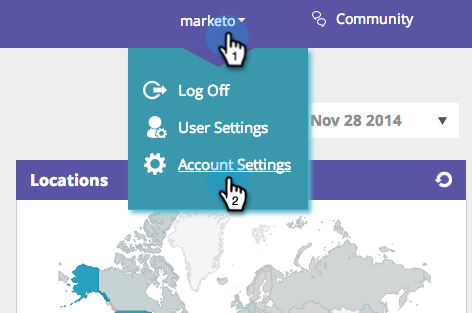
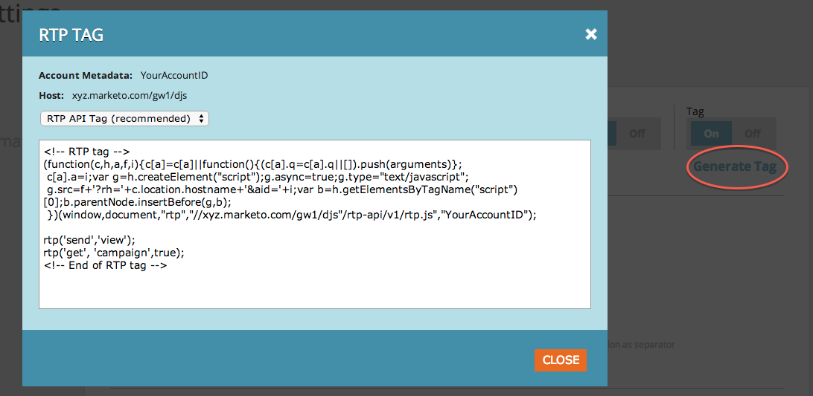
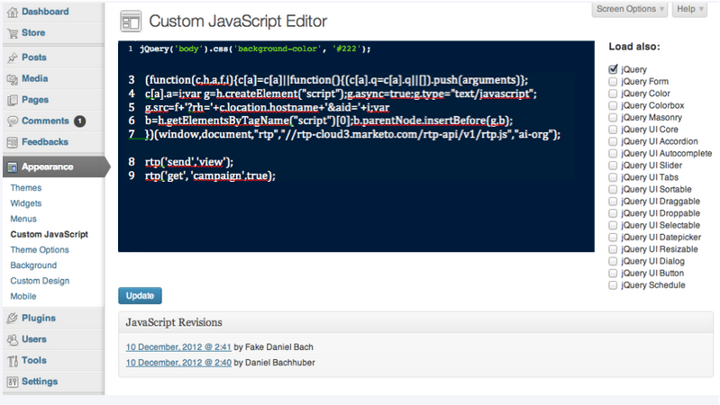

# 在 WordPress Enterprise 上實施 RTP {#implementing-rtp-on-wordpress-enterprise}

若要實作您的[!UICONTROL RTP tag]，請遵循下列安裝指示：

1. 前往 **[!UICONTROL Account Settings]**。

   答： 如果您已從支援部門收到JavaScript標籤 — 請繼續執行步驟3。

   

1. 在[!UICONTROL Domain]下，找到相關網域並按一下&#x200B;**[!UICONTROL Generate Tag]**。

   

1. 複製RTP JavaScript標籤。

1. 以管理員使用者身分登入您的[!DNL WordPress]帳戶

   答： 在&#x200B;**[!UICONTROL Appearance]**&#x200B;底下，移至&#x200B;**[!UICONTROL Custom JavaScript]**。
   b. 將RTP Javascript標籤貼到現有程式碼的正後方。

   

   >[!CAUTION]
   >
   >貼上程式碼時，請排除下列標籤：
   >
   >* `<!-- RTP tag -->`
   >* ``
   >* `<!-- End of RTP tag -->`
   >
   >僅插入指令碼本身。

1. 按一下「**[!UICONTROL Update]**」。
