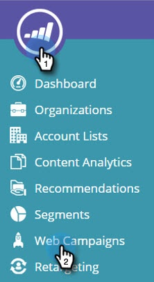
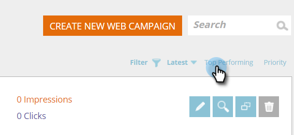

# 按照最新或最佳效能排序網頁行銷活動 {#sort-web-campaigns-by-latest-or-top-performing}

您可以用數種不同的方式排序您的網路行銷活動。

1. 前往 **[!UICONTROL Web Campaigns]**。

   

1. 選取排序型別。

   >[!NOTE]
   >
   >**定義**
   >
   >**[!UICONTROL Latest]** — 將根據行銷活動的建立日期排序。 最上方的最新行銷活動。
   >
   >**[!UICONTROL Top Performing]** — 將根據點進率排序行銷活動。 頂端的最高點進。

   

   是的，真的那麼簡單。
